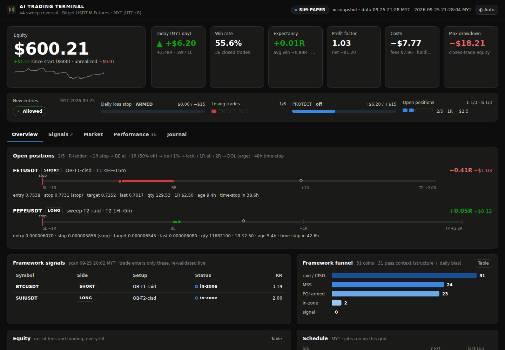
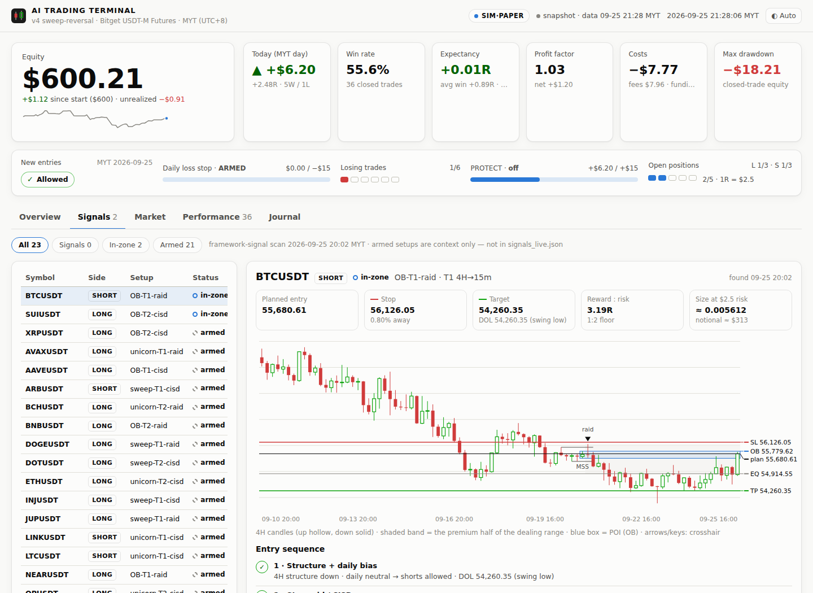

# AITradingTerminal

Autonomous crypto-futures trading bot built on ICT / Smart Money Concepts, implementing
[**FRAMEWORK.md** (v4 sweep-reversal)](FRAMEWORK.md) for Bitget USDT-M futures. It detects
liquidity-sweep reversals (a stop raid or CISD, then a structure shift, premium/discount, and an
FVG / Order Block / Unicorn entry), enforces a strict risk shell, and reports to Telegram and Gmail.

It ships with three ways to run and watch it:

| | What | Start it |
|---|---|---|
| **Automated trading** | 24/7 daemon: scans, framework signals, trade loop, R-ladder management, reports, journal | `python run_bot.py daemon` |
| **UX dashboard** | `dashboard/index.html`: opens from disk, or live from a read-only local server | `python run_bot.py serve` |
| **Terminal UI** | curses app: positions with R-ladders, signals with chart + checklist, scanner, trades, journal, log, job hotkeys | `python run_bot.py tui --run` |

Pure Python standard library (3.9+), exchange-adapter design, **DEMO by default**. Live orders stay
refused until the demo record proves positive (see [Safety](#safety)).



## Quick start

### 1. Try everything offline (synthetic market, no keys, no network)

```bash
python run_bot.py replay --days 7      # fast-forward the whole bot over 7 days of a synthetic market
python run_bot.py --sim tui            # browse the result in the terminal UI (q to quit)
python run_bot.py --sim serve          # … or in the browser at http://127.0.0.1:8787
```

The synthetic market is deterministic, has realistic volatility, market beta and scripted stop hunts,
and never peeks ahead. Replays run the *same* jobs on the *same* schedule as the live daemon and write
into `sim/` (state, journals, reports with PDFs, dashboard), never into your paper account.

### 2. Paper-trade on live Bitget data (the default mode)

```bash
cp .env.example .env                   # optional: Telegram + Gmail credentials
python run_bot.py cycle                # one scan → signals → trade pass, right now
python run_bot.py daemon               # 24/7 on the MYT schedule (Ctrl+C / SIGTERM to stop)
python run_bot.py tui --run            # the same daemon, inside the terminal UI
```

Paper mode uses only Bitget's public market data. Fills are simulated with taker fees (0.06%),
slippage, and 8-hourly funding. Stops and targets that trade while the machine is off still fill at
their levels, because the ladder replays the 1-minute candles it missed.

### 3. Bitget demo trading

Create **demo** API keys on Bitget, put them in `.env`, and set `TRADING_MODE=demo`. Orders then go to
Bitget's demo environment (`paptrading` header). SL/TP ride on the entry, and a TP1 plan plus a
trailing plan are placed on the exchange, so the ladder works with the machine off.

## Commands

Global options work before or after the command: `--sim` (synthetic market, data in `./sim`),
`--home DIR`, `--mode paper|demo|live`, `--quiet` (no Telegram/Gmail), `-v`.

| Command | Does |
|---|---|
| `scan` | Routine 1 (top 20 movers + 20 losers, 24h vol ≥ $1M, PDH/PDL state) + Module A sweeps + Routine 2 daily failure → Telegram + Gmail |
| `signals` | The v4 engine over **all** coins → `state/signals_live.json` (signals + in-zone watch) → Telegram + Gmail |
| `cycle` | `scan` → `signals` → `trade` (what the daemon runs every 4 h) |
| `trade` | Enter **only** coins listed in `signals_live.json`, each re-validated on fresh candles |
| `manage` | R-ladder + 48h time-stop on open positions |
| `report [--slot 07:00\|19:00]` | Net-of-fees report (markdown + PDF) → Telegram + Gmail |
| `journal` · `dashboard` | Rewrite today's journal · `dashboard/index.html` |
| `daemon` | Everything above on the schedule below, with catch-up after downtime |
| `serve [--port 8787] [--run]` | Live dashboard, read-only; `--run` also runs the daemon |
| `tui [--run]` | Terminal UI; `--run` embeds the daemon |
| `status` | One-shot colour snapshot (works on any terminal, no curses) |
| `replay --days N [--source sim\|bitget]` | Fast-forward the complete bot over past days, no lookahead |

### Schedule (MYT, UTC+8)

| Job | When |
|---|---|
| scan + research + signals + trade pass | every 4 h at 00:02, 04:02, 08:02, 12:02, 16:02, 20:02 (just after each Bitget 4H close) |
| trade | every 30 min (:00:30 / :30:30), as each 15m/5m entry candle closes |
| manage | every 5 min |
| daily report + PDF | 07:00 (the market day just ended) and 19:00 (the day so far) |
| journal | rewritten after every job; one file per market day, even with zero trades |

Market day = 07:00 → 07:00 MYT (journal + reports). The protection-shell gates reset at 00:00 MYT,
as the framework states.

## How the framework maps to the code

| Framework | Code |
|---|---|
| Entry sequence, T1 (4H→15m) → T2 (1H→5m), first signal wins | `strategy.evaluate()` → `_reversal()` |
| 1 · ITH/ITL structure + PDH/PDL daily bias, DOL | `market_structure()`, `_swing_seq()`, `daily_bias()`, `draw_on_liquidity()` |
| 2 · stop raid within ~30 bars, or CISD | `liquidity_sweep()`, `_cisd()` |
| 3 · MSS / CHoCH | `structure_shift()` |
| 4 · premium / discount | `dealing_range()` |
| 5 · FVG (Unicorn via breaker) or Order Block; tags sweep-/unicorn-/OB- | `find_fvgs()`, `breaker_overlap()`, `order_block()`, `poi_zones()` |
| 6 · solid-body entry candle, stop ≥0.8% & ≤12%, target DOL with 1:2 floor | `confirmation()`, `stop_for()` |
| Protection shell constants | `paper_bot.py`: `RISK_PER_TRADE`, `MAX_OPEN_POSITIONS`, `CORR_MAX_PER_SIDE`, `DAILY_MAX_LOSS`, `MAX_LOSSES_PER_DAY`, `DAILY_TARGET`, `MAX_TRADE_AGE_HOURS` |
| R-ladder (−1R · +1R 50% off + BE + trail · 1% trail · lock +1R at +2R · DOL · 48h) | `paper_bot.mark()` (paper), `bitget_broker.BitgetBroker` (demo/live, exchange-held) |
| Module A liquidity-sweep screen (degraded) | `sweep_screen.py`, spec in [MODULE_A_liquidity_sweep.md](MODULE_A_liquidity_sweep.md) |
| Routine 1 / Routine 2 | `run_bot.job_scan()`, `strategy.daily_failure()` |
| Trade only coins in `signals_live.json`, re-validated | `run_bot.job_trade()`, enforced by `tests/test_e2e.py` |
| Net-of-fees daily report + PDF | `bitget_report.py` (+ `pdfgen.py`) |
| TradFi/RWA exclusion | `exchange.is_tradfi()`, `exchange.universe()` |

## Interpretation notes

Where the framework text leaves a choice, these are the choices made. Each is a named constant or a
single function, so it's easy to change.

- **Daily bias** uses the previous day's close against the day before's range: above its high is
  bullish, below its low is bearish, otherwise neutral. The daily-*failure* pattern is deliberately
  *not* part of the bias, since it has no edge and stays research-only.
- **Swing grades.** Liquidity pools (raids, DOL) are 5-bar fractals. Structure shifts and the
  ITH/ITL hierarchy use 3-bar short-term swings, which is ICT's STH/STL → ITH/ITL hierarchy.
- **Raid** means the first pierce of a fresh pool within the last 30 bars, reclaimed by a close within
  3 bars, with the raid extreme never undercut since.
- **CISD** is read on the *last* delivery leg: a series of ≥2 against-closes into a 5-bar swing, then a
  close back through the leg's origin. A single engulfing candle at a minor wiggle is noise. (The
  looser reading fired on ~10% of all coins at any moment in testing.)
- **POI timeframe.** The POI is read on the structure timeframe; the entry timeframe supplies the
  confirmation candle. The confirmation must be the *latest* closed entry candle with a body ≥50%.
- **Stop** sits 0.1% beyond the raid extreme, is floored at 0.8%, and the setup is rejected beyond
  12%. **Target** is `max(DOL, entry + 2R)`: "≥ 1:2 floor" is read as a floor, like the stop's.
- **`signals_live.json`** holds exactly "coins meeting the framework + in-zone watch". Setups still
  waiting for a retrace ("armed") go to `armed.json` for context and are never traded.
- **Realized P&L for the gates** is net: fees and funding included, and TP1 partials count when they
  fill.
- **Tiers.** `TIERS` holds T1, T2 and a disabled T3 (15m→1m, the floored S15 entry), which reconciles
  "holds the 3 tiers" with "tries T1 → T2".
- **Scan anchor.** The 4-hour cycle runs 2 minutes after each Bitget 4H close so T1 structure is
  always fresh (configurable with `SCAN_OFFSET`).
- **Module A** thresholds are reconstructed (the original spec wasn't provided); see its document.

## Files and outputs

```
run_bot.py          jobs, daemon, replay, CLI          strategy.py      the v4 engine
paper_bot.py        protection shell + R-ladder         sweep_screen.py  Module A
bitget_report.py    net-of-fees report (md/html/pdf)    journal.py       journal/YYYY-MM-DD.md
exchange.py         Bitget public + signed REST         bitget_broker.py demo/live execution
sim.py              synthetic + historical replay mkts  dashboard.py     snapshot, HTML, server
tui.py              terminal UI + `status`              notify.py        Telegram + Gmail
store.py · schedule.py · timeutil.py · config.py · util.py · pdfgen.py
dashboard/template.html   the dashboard front end (vanilla JS/SVG, no CDN)

state/   state.json · signals_live.json · armed.json · sweeps.json · scan.json · daily_failure.json
         events.jsonl · schedule.json · bot.log · outbox/ (every notification, also when unsent)
journal/ YYYY-MM-DD.md        reports/ YYYY-MM-DD_0700.pdf|md …        dashboard/index.html
```

The terminal UI (positions tab excerpt):

```
 AI TRADING TERMINAL   v4 sweep-reversal · Bitget USDT-M Futures                  SIM·PAPER   2026-09-25 21:28:29 MYT
 Equity $600.21 (+$1.12)   Today +$6.20 +2.48R 5W/1L   Win 55.6% · Exp +0.01R · PF 1.03 · 36 trades
 ✓ ENTRIES ALLOWED   Loss stop ARMED $0.00/−$15 · losses 1/6 · PROTECT off +$6.20/+$15 · open 2/5 (L1/3 S1/3)

 1 Overview   2 Positions   3 Signals   4 Scanner   5 Sweeps   6 Daily-fail   7 Trades   8 Journal   9 Log
 OPEN POSITIONS  2/5                                                     SIGNALS  scan 20:02
 FETUSDT      SHORT OB-T1-cisd        -0.41R   −$1.03                    SYMBOL      D SETUP            STATUS     RR
      ┃──────────●━━━━━━━────────────────◆─────────────────┼             BTCUSDT     S OB-T1-raid       in-zone  3.19
     SL                BE               1R                TP             SUIUSDT     L OB-T2-cisd       in-zone  2.00
```

Keys: `1-9` tabs · `↑↓/jk` move · `s` scan cycle · `g` signals · `t` trade · `m` manage · `p` report ·
`d` dashboard · `r` refresh · `?` help · `q` quit. On Windows, install `windows-curses` for the TUI;
`status` works everywhere.



## Running it 24/7

**Linux (systemd)**, as `/etc/systemd/system/aitt.service`:

```ini
[Unit]
Description=AI Trading Terminal (v4 sweep-reversal)
After=network-online.target

[Service]
WorkingDirectory=/opt/AITradingTerminal
ExecStart=/usr/bin/python3 run_bot.py daemon
Restart=always
RestartSec=20

[Install]
WantedBy=multi-user.target
```

Then run `sudo systemctl enable --now aitt`. The daemon catches up on a missed scan cycle or report
at start-up, and the paper ladder replays the candles it missed.

**Windows:** run `python run_bot.py daemon` from Task Scheduler ("At startup", restart on failure).

## Validation workflow (from demo to live)

1. `python run_bot.py replay --source bitget --days 30 --top 40` replays real Bitget history, with
   candles cached under `replay/cache/`. The report breaks results down by family, tier and trigger.
2. Paper or demo trade the daemon until the record is meaningful.
3. Live is only accepted when `LIVE_CONFIRM=I-ACCEPT-LIVE-RISK` is set **and** the edge gate passes
   on this home's closed trades: at least 30 trades, positive net and expectancy, and PF ≥ 1.2
   (`EDGE_MIN_TRADES`, `EDGE_MIN_PROFIT_FACTOR`).

## Testing

```bash
python -m unittest discover -s tests -t .    # 61 tests, ~15 s, fully offline
```

The suite covers:
- every engine primitive, plus full long / short-mirror / CISD / OB / unicorn scenarios;
- each R-ladder rung, the gates and sizing;
- Bitget request signing and parsing (fake transport);
- the synthetic market's no-lookahead guarantee;
- the PDF writer;
- an end-to-end replay that asserts the framework invariants: every entry was listed by the signal
  scan, positions never exceed 5 open or 3 per side, the accounting identities hold, and there is a
  journal for every market day.

## Safety

- **DEMO by default.** Paper needs no keys; demo uses Bitget demo keys; live is refused by two
  independent locks (explicit confirmation + the edge gate).
- The web dashboard is **read-only** and binds to `127.0.0.1` by default. Nothing in it can place,
  change or cancel orders.
- Secrets live in `.env` (git-ignored).
- The demo/live order path (`bitget_broker.py`) follows Bitget's v2 API and is unit-tested against a
  fake transport, but it has **not yet been exercised against Bitget itself**. Run it on demo first
  and check SL/TP/plan orders in the Bitget demo UI.
- The synthetic market is for testing and demos only; its results say nothing about real edge.
